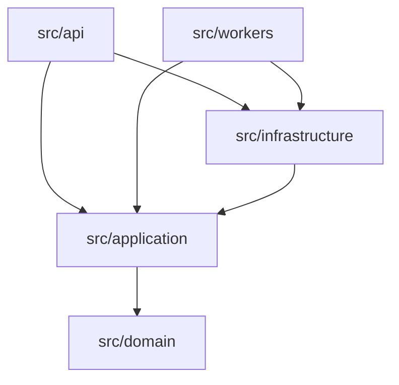
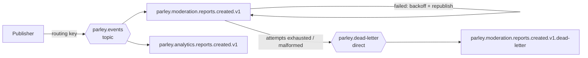
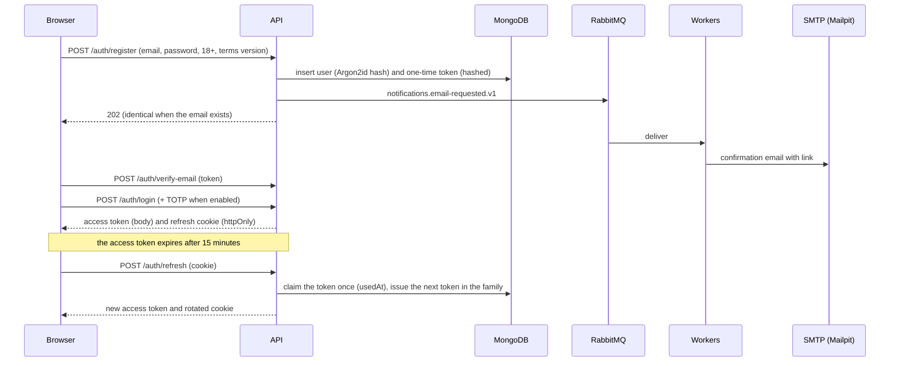
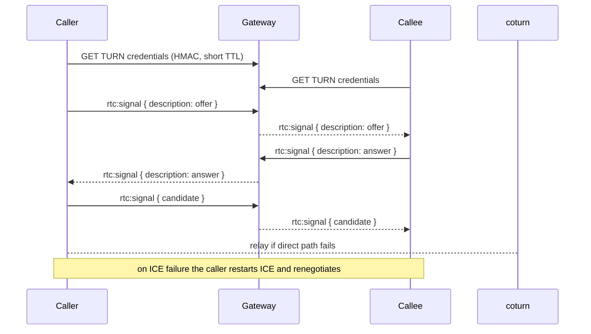
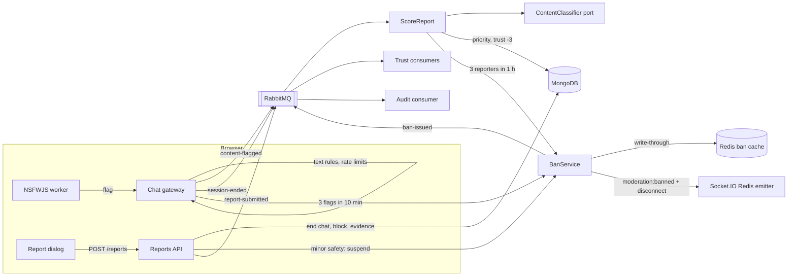
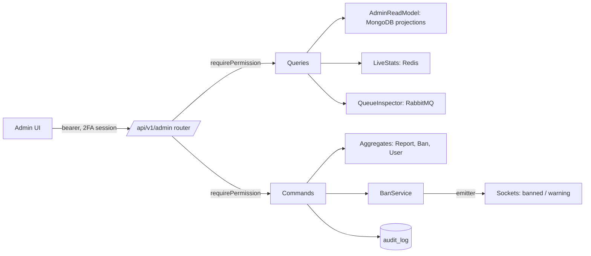

# Architecture

Status: Phases 1-7 implemented (foundation, identity, matchmaking, text and video chat, moderation and safety, admin panel, site configuration). Monetisation is deferred ([ADR 0015](decisions/0015-free-launch.md)). Sections marked _planned_ describe the target design that later phases implement; update them as features land.

## Components

```mermaid
flowchart LR
  subgraph Client
    FE[Next.js frontend]
  end
  subgraph Backend
    API[API process<br/>Express + Socket.IO]
    WK[Workers process<br/>RabbitMQ consumers]
  end
  subgraph Infrastructure
    MDB[(MongoDB)]
    RDS[(Redis)]
    MQ[[RabbitMQ]]
    TURN[coturn]
    MAIL[Mailpit / SMTP]
  end
  FE -- HTTPS / WSS --> API
  FE -- STUN / TURN --> TURN
  FE <-. WebRTC media, peer to peer or relayed .-> FE
  API --> MDB
  API --> RDS
  API -- publish --> MQ
  MQ -- consume --> WK
  WK --> MDB
  WK --> RDS
  WK --> MAIL
  API -. Socket.IO Redis adapter .-> RDS
```

The API is stateless: any instance can serve any request or socket, because session state lives in Redis and the Socket.IO Redis adapter fans events out across instances.

### Layers



Dependencies point inwards and ESLint fails the build when they don't. `src/infrastructure/infrastructure.ts` is the shared composition root; `src/api/server.ts` and `src/workers/main.ts` are the process entry points.

## Messaging (implemented in Phase 1)

- One durable topic exchange `parley.events`; routing key = event definition key, versioned (e.g. `reports.created.v1`). Payloads are validated with the event's zod schema when published and when consumed.
- Envelope: `{ eventId (UUID v7), occurredAt (ISO 8601), payload }`, persistent, published with confirms (10 s timeout while the broker is unreachable).
- Each subscriber declares its own quorum queue `parley.{subscriber}.{routingKey}`.
- Retries are counted by the consumer: on failure it waits `RABBITMQ_RETRY_DELAY_MS * 2^(attempt-1)` (max 30 s), republishes the message with `x-parley-attempt` incremented (confirmed), then acks the original. After `RABBITMQ_DELIVERY_LIMIT` attempts the message is dead-lettered. Malformed or schema-invalid messages are dead-lettered immediately. RabbitMQ 4 does not count `nack` requeues toward a quorum queue's delivery limit, so the queue's `x-delivery-limit` only guards against consumers that crash mid-message.
- The connection recovers automatically with exponential backoff; consumers re-subscribe on every reconnect.



## Identity and sessions (implemented in Phase 2)



- **Principals**: `user` (account) or `anonymous` (device). Both carry the accepted Terms version; staff also carry roles and an `mfa` flag.
- **Devices**: the browser sends a SHA-256 fingerprint and the API stores only an HMAC of it. Devices are the unit for anonymous sessions and, from Phase 5, device bans.
- **Refresh families**: every sign-in or anonymous session starts a family, and each refresh replaces its token. Replaying a used token more than 5 seconds later revokes the family. Password reset and 2FA enrolment revoke every family of the account.
- **Seed**: `src/tools/seed.ts` creates the first SuperAdmin (idempotent), who must enrol 2FA before staff permissions apply.

## Matchmaking flow (implemented in Phase 3)

```mermaid
sequenceDiagram
  participant A as Client A
  participant G as Socket.IO gateway (API)
  participant R as Redis
  participant B as Client B
  A->>G: queue:join(mode, interests, language)
  G->>G: validate payload (zod); principal from the handshake token
  G->>R: EVAL pair.lua (atomic: find compatible waiting user or enqueue)
  alt partner found
    R-->>G: partner B, session id
    G-->>A: match:found(sessionId, role=caller)
    G-->>B: match:found(sessionId, role=callee)
  else nobody compatible
    R-->>G: enqueued
    G-->>A: ack { status: queued } (retries every 2 s)
  end
```

- **Atomic pairing**: one Lua script reads the queue oldest-first (up to 200 tickets), skips blocked, recent and language-incompatible candidates, picks the most shared interests, and either creates the session for both or queues the caller. Concurrent joins cannot double-match.
- **Interest fallback**: someone with interests pairs without a shared interest only once both sides have waited `MATCH_INTEREST_FALLBACK_MS`. Waiting sockets retry every 2 s and keep their original enqueue time.
- **Events across instances**: every socket joins the room `subject:{id}`; the Redis adapter delivers `io.to(room).emit` to whichever instance holds the socket.
- **Presence**: each instance refreshes `mm:presence:{subject}` for its sockets every 10 s (30 s TTL). A sweeper, run by one instance at a time under a Redis lease, ends sessions and clears tickets of subjects without presence (for example after an instance crash).
- **Ban checks and trust pools** hook into the connect step and the pairing script in Phase 5.

## WebRTC signaling (implemented in Phase 4)



- **TURN credentials**: `GET /api/v1/rtc/ice-servers` returns STUN plus TURN with username `<expiry>:<subject>` and password base64(HMAC-SHA1(TURN_SECRET, username)). coturn (`use-auth-secret`) checks the HMAC and expiry itself.
- **Relay only**: clients that enable the privacy setting use `iceTransportPolicy: relay`, so peers only ever see coturn's address.
- **Recovery**: ICE restart after 3 s in `disconnected` or immediately on `failed`; perfect negotiation makes restarts safe from either side.
- **Media never reaches the API**: only SDP and candidates pass through the gateway.

## Moderation pipeline (implemented in Phase 5)



- **Immediate safety on the request path**, ranking and learning in the workers ([ADR 0012](decisions/0012-moderation-pipeline.md)).
- **Bans** live in MongoDB with a Redis write-through cache checked at connect and on every search; enforcement reaches every API instance through the Socket.IO Redis emitter. Every socket joins `subject:`, `device:`, `net:` and `subnet:` rooms ([ADR 0013](decisions/0013-bans-trust-and-pools.md)).
- **Pools**: matchmaking queues are keyed `mm:queue:{mode}:{pool}` with pools `standard`, `low-trust` (trust below 25) and `shadow` (shadow-banned).
- **Evidence** is the report snapshot plus the last 10 messages from a 15-minute Redis buffer (`chat:recent:{session}`); it expires through a TTL index (30 days, 365 for minor safety). Staff access is audit-logged.
- **Minor safety**: see [minor-safety-workflow.md](minor-safety-workflow.md).

## Admin panel (implemented in Phase 6)



- Read side and commands are separate ([ADR 0014](decisions/0014-admin-read-side.md)): lists come from projections, each staff action is one audited use case.
- Decisions on a report lift the automatic suspension it caused, then warn (`moderation:warning`) or ban; trust moves -15 for the reported person when upheld, -5 for the reporter when dismissed.
- Role changes sign the person out everywhere, so the next session carries the new roles and needs 2FA.
- `create-staff` bootstraps staff (2FA enabled) from the API container.

## Site configuration (implemented in Phase 7)

One `site_config` document (maintenance, announcement, feature switches), cached in each API process for 15 seconds. The socket admission, the gateway's search and the registration route read it; staff bypass maintenance. Public at `GET /api/v1/site`, edited in the admin panel. See [ADR 0015](decisions/0015-free-launch.md).

## Health

- `/health/live`: process is running (container health checks).
- `/health/ready`: MongoDB ping, Redis ping, RabbitMQ connection state; 503 when any check is unhealthy; each check times out after 3 s. The payload exposes only component names and statuses; failure details go to the logs.

## Process lifecycle

- Configuration is validated before anything starts; invalid configuration exits with every problem listed.
- The API and workers start even when a dependency is down (readiness reports it; Redis and RabbitMQ reconnect in the background).
- SIGTERM/SIGINT: stop accepting connections, stop consumers, close broker/Redis/Mongo connections; forced exit after 15 s.

## Free MVP hardening (2026-10-28)

Required Mongo indexes are now awaited before infrastructure creation returns. A conflicting/failed index blocks startup and closes clients; the previous availability-first startup description does not apply to Mongo index failures. New reports persist a versioned recovery marker and incomplete scoring flag in the same Mongo insert. Workers reconcile every 10 seconds independently of Rabbit delivery, restore durable partner blocks, retry pending minor suspension and finish scoring effects. Per-key trust effect IDs make partial retries safe. Historical already-scored reports are not automatically charged again. Evidence saved before a failed report insert may be orphaned until its TTL; full multi-document atomicity is not claimed. Ban audit delivery outside a recoverable report workflow still needs broader outbox coverage before a public-launch claim. WebSocket-only transport is deliberate; validate WSS at the reverse proxy.
