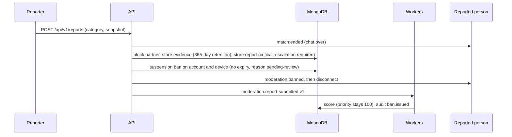

# Minor-safety workflow

How Parley handles reports that someone appears to be under 18, or that a chat involved sexual content with a minor. This document describes what the software does and what staff must do in the admin panel. It is operational guidance, not legal advice; an operator must confirm its obligations with counsel in each jurisdiction it serves.

## Categories

| Category               | Shown to the reporter as         |
| ---------------------- | -------------------------------- |
| `appears-minor`        | Appears to be under 18           |
| `child-sexual-content` | Sexual content involving a minor |

## What happens automatically

1. **Priority**: the report is created with priority 100 and tier `critical`, ahead of every other report, and keeps it after scoring.
2. **Instant suspension**: the reported account (if any) and device get a full ban with no expiry and the reason `pending-review`. They are disconnected immediately and refused on reconnect. They see "A report about you is being reviewed" on `/banned` and may appeal.
3. **Evidence preservation**: the snapshot and the last messages are stored with a 365-day retention (`MINOR_SAFETY_RETENTION_DAYS`, minimum 365) instead of the standard 30 days. In the United States, 18 U.S.C. § 2258A requires providers to preserve the contents of a report to NCMEC for one year.
4. **Escalation flag**: the report carries `escalation: "required"` until a staff member records the outcome.
5. **Restricted access**: evidence of these reports is only returned to staff with the `moderation.escalate` permission (Moderator, Admin, SuperAdmin), and every view is written to the audit log (`evidence.viewed`).

## What staff do (admin panel)

1. **Review promptly.** Critical reports are at the top of the queue (Moderation queue, marked "escalation due"); only staff with `moderation.escalate` can open their evidence and decide them. Do not download, copy, forward or screenshot the evidence; view it only in the admin panel.
2. **Decide**:
   - _Apparent minor, no sexual content_: keep a permanent ban with reason `underage` (Parley is 18+), lift the suspension's `pending-review` reason. No authority report is required unless other facts call for it; set escalation to `not-required`.
   - _Sexual content involving a minor (apparent child sexual abuse material or exploitation)_: keep a permanent ban with reason `minor-safety` on account and device, and add the network if the report shows repeated abuse.
   - _Unfounded report_: lift the suspension, set escalation to `not-required`; the reporter's trust is lowered as for any rejected report.
3. **Report to the authority** when sexual content involving a minor is apparent:
   - United States: the NCMEC CyberTipline (report.cybertip.org). US providers must report apparent child sexual abuse material they become aware of (18 U.S.C. § 2258A).
   - Elsewhere: the national hotline (for example via INHOPE, inhope.org) or the authority the operator's counsel designates.
   - Include the report id, timestamps, the evidence as the hotline instructs and the hashed identifiers; never include the reporter's identity unless required.
4. **Record the outcome** in the report's Escalation form: "Reported to the authority" with the hotline's reference number, or "Not required". The action is audit-logged (`report.escalated`). Dismissing the report sets it to not required automatically.
5. **Preserve**: do not lift the retention hold; evidence is deleted automatically when it ends. Extend it only when an authority requests preservation in writing.

## Staff wellbeing

Reviewing this material is harmful. Rotate reviewers, limit session length and offer support. The queue keeps snapshots blurred until a reviewer reveals them, and loads evidence only on request.

## Related

- Feature doc: [features/minor-safety.md](features/minor-safety.md)
- Evidence retention: [features/evidence-retention.md](features/evidence-retention.md)
- ADR [0012](decisions/0012-moderation-pipeline.md)
