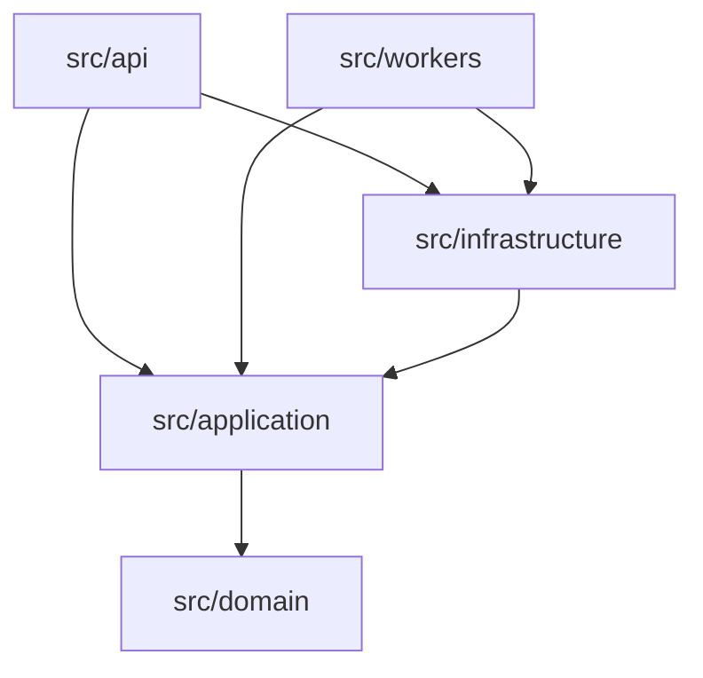
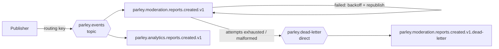
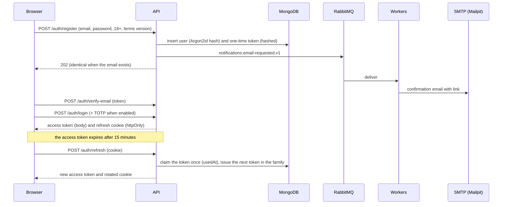
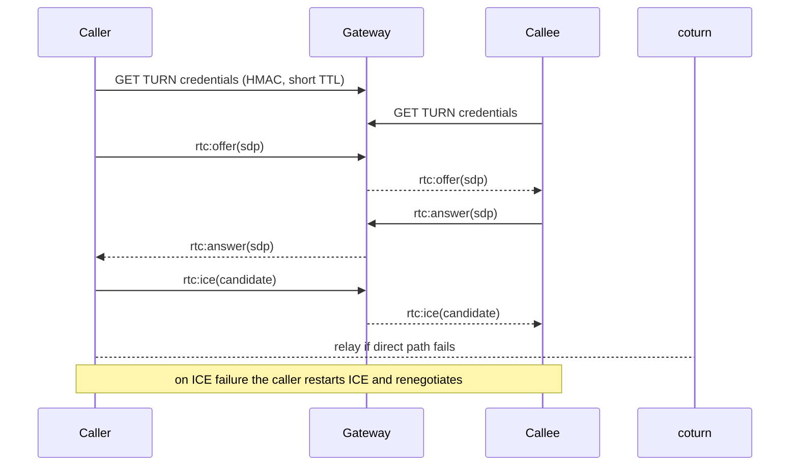
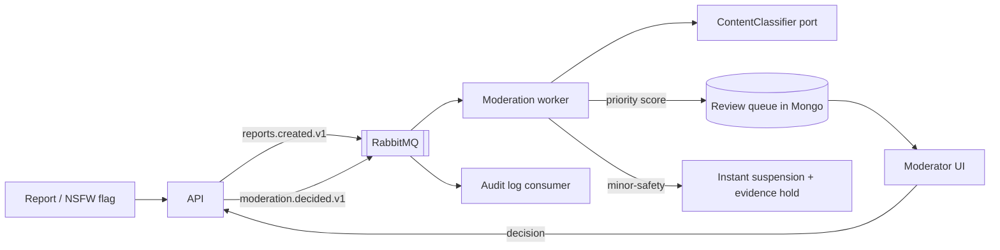

# Architecture

Status: Phases 1-3 implemented (foundation, identity, matchmaking and text chat). Sections marked _planned_ describe the target design that later phases implement; update them as features land.

## Components

```mermaid
flowchart LR
  subgraph Client
    FE[Next.js frontend]
  end
  subgraph Backend
    API[API process<br/>Express + Socket.IO]
    WK[Workers process<br/>RabbitMQ consumers]
  end
  subgraph Infrastructure
    MDB[(MongoDB)]
    RDS[(Redis)]
    MQ[[RabbitMQ]]
    TURN[coturn]
    MAIL[Mailpit / SMTP]
  end
  FE -- HTTPS / WSS --> API
  FE -- STUN / TURN --> TURN
  FE <-. WebRTC media, peer to peer or relayed .-> FE
  API --> MDB
  API --> RDS
  API -- publish --> MQ
  MQ -- consume --> WK
  WK --> MDB
  WK --> RDS
  WK --> MAIL
  API -. Socket.IO Redis adapter .-> RDS
```

The API is stateless: any instance can serve any request or socket, because session state lives in Redis and the Socket.IO Redis adapter fans events out across instances.

### Layers



Dependencies point inwards and ESLint fails the build when they don't. `src/infrastructure/infrastructure.ts` is the shared composition root; `src/api/server.ts` and `src/workers/main.ts` are the process entry points.

## Messaging (implemented in Phase 1)

- One durable topic exchange `parley.events`; routing key = event definition key, versioned (e.g. `reports.created.v1`). Payloads are validated with the event's zod schema when published and when consumed.
- Envelope: `{ eventId (UUID v7), occurredAt (ISO 8601), payload }`, persistent, published with confirms (10 s timeout while the broker is unreachable).
- Each subscriber declares its own quorum queue `parley.{subscriber}.{routingKey}`.
- Retries are counted by the consumer: on failure it waits `RABBITMQ_RETRY_DELAY_MS * 2^(attempt-1)` (max 30 s), republishes the message with `x-parley-attempt` incremented (confirmed), then acks the original. After `RABBITMQ_DELIVERY_LIMIT` attempts the message is dead-lettered. Malformed or schema-invalid messages are dead-lettered immediately. RabbitMQ 4 does not count `nack` requeues toward a quorum queue's delivery limit, so the queue's `x-delivery-limit` only guards against consumers that crash mid-message.
- The connection recovers automatically with exponential backoff; consumers re-subscribe on every reconnect.



## Identity and sessions (implemented in Phase 2)



- **Principals**: `user` (account) or `anonymous` (device). Both carry the accepted Terms version; staff also carry roles and an `mfa` flag.
- **Devices**: the browser sends a SHA-256 fingerprint and the API stores only an HMAC of it. Devices are the unit for anonymous sessions and, from Phase 5, device bans.
- **Refresh families**: every sign-in or anonymous session starts a family, and each refresh replaces its token. Replaying a used token more than 5 seconds later revokes the family. Password reset and 2FA enrolment revoke every family of the account.
- **Seed**: `src/tools/seed.ts` creates the first SuperAdmin (idempotent), who must enrol 2FA before staff permissions apply.

## Matchmaking flow (implemented in Phase 3)

```mermaid
sequenceDiagram
  participant A as Client A
  participant G as Socket.IO gateway (API)
  participant R as Redis
  participant B as Client B
  A->>G: queue:join(mode, interests, language)
  G->>G: validate payload (zod); principal from the handshake token
  G->>R: EVAL pair.lua (atomic: find compatible waiting user or enqueue)
  alt partner found
    R-->>G: partner B, session id
    G-->>A: match:found(sessionId, role=caller)
    G-->>B: match:found(sessionId, role=callee)
  else nobody compatible
    R-->>G: enqueued
    G-->>A: ack { status: queued } (retries every 2 s)
  end
```

- **Atomic pairing**: one Lua script reads the queue oldest-first (up to 200 tickets), skips blocked, recent and language-incompatible candidates, picks the most shared interests, and either creates the session for both or queues the caller. Concurrent joins cannot double-match.
- **Interest fallback**: someone with interests pairs without a shared interest only once both sides have waited `MATCH_INTEREST_FALLBACK_MS`. Waiting sockets retry every 2 s and keep their original enqueue time.
- **Events across instances**: every socket joins the room `subject:{id}`; the Redis adapter delivers `io.to(room).emit` to whichever instance holds the socket.
- **Presence**: each instance refreshes `mm:presence:{subject}` for its sockets every 10 s (30 s TTL). A sweeper, run by one instance at a time under a Redis lease, ends sessions and clears tickets of subjects without presence (for example after an instance crash).
- **Ban checks and trust pools** hook into the connect step and the pairing script in Phase 5.

## WebRTC signaling (planned, Phase 4)



## Moderation pipeline (planned, Phase 5)



## Health

- `/health/live`: process is running (container health checks).
- `/health/ready`: MongoDB ping, Redis ping, RabbitMQ connection state; 503 when any check is unhealthy; each check times out after 3 s. The payload exposes only component names and statuses; failure details go to the logs.

## Process lifecycle

- Configuration is validated before anything starts; invalid configuration exits with every problem listed.
- The API and workers start even when a dependency is down (readiness reports it; Redis and RabbitMQ reconnect in the background).
- SIGTERM/SIGINT: stop accepting connections, stop consumers, close broker/Redis/Mongo connections; forced exit after 15 s.
