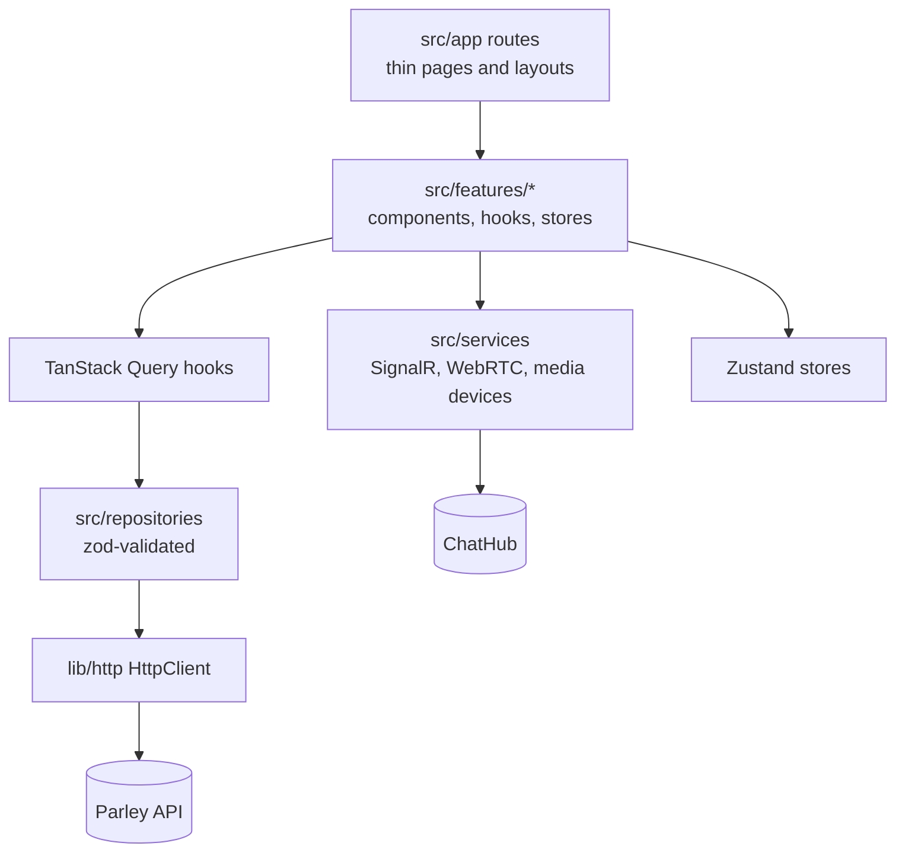

# Architecture

Status: Phase 1 (foundation). Sections marked _planned_ describe the target design.

## Layers



- **Routes** compose feature components and export metadata. No logic.
- **Features** own UI and state for one capability.
- **Repositories** are the only code that talks HTTP. Each method validates the response with zod and returns typed data. Errors surface as `ApiError` (wrapping RFC 7807 ProblemDetails; status 0 means a network failure).
- **Services** (Phase 3+) wrap long-lived browser resources: the SignalR connection (automatic reconnect with backoff), RTCPeerConnection (ICE restart), media devices.

## Rendering

- Cache Components and Partial Prefetching are enabled. Public pages (landing, status shell, static pages) are prerendered static shells; client islands hydrate the interactive parts.
- Chat and admin are separate route groups, so their bundles are code-split from the landing page. Heavy modules (NSFW model, emoji picker) are loaded with dynamic `import()` when first needed.

## State

| Kind               | Tool                                | Example                        |
| ------------------ | ----------------------------------- | ------------------------------ |
| Server state       | TanStack Query                      | readiness report, reports list |
| Client preferences | Zustand + persist (`skipHydration`) | interests, language            |
| Real-time session  | Zustand (planned)                   | match state, partner typing    |
| Theme              | next-themes (class strategy)        | light / dark / system          |

## Text chat flow (planned, Phase 3)

```mermaid
sequenceDiagram
  participant U as User
  participant UI as Chat feature
  participant S as SignalR manager
  participant H as ChatHub
  U->>UI: Start text
  UI->>S: connect (access or anonymous token)
  S->>H: JoinQueue(mode, interests, language)
  H-->>S: Searching
  H-->>S: Matched(sessionId)
  UI-->>U: Connected; message box focused
  U->>UI: type
  UI->>S: Typing / SendMessage
  H-->>S: PartnerLeft
  UI-->>U: Partner left; Next or Stop
```

## Video call flow (planned, Phase 4)

The caller creates the offer after `Matched`; SDP and ICE candidates travel over the hub. TURN credentials are fetched from the API per session. On `iceconnectionstatechange = failed` the caller performs an ICE restart; if that fails within a timeout, the session ends with a clear message.
