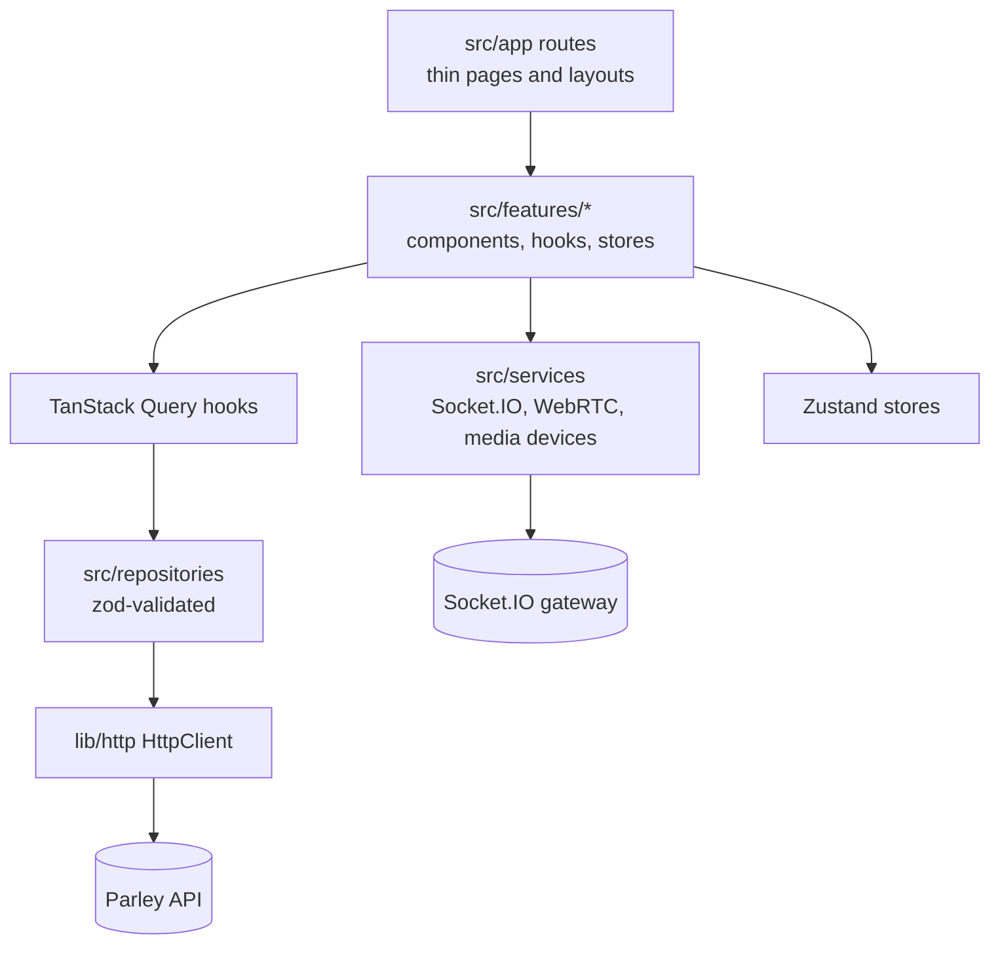

# Architecture

Status: Phases 1-6 implemented. Sections marked _planned_ describe the target design.

## Layers



- **Routes** compose feature components and export metadata. No logic.
- **Features** own UI and state for one capability.
- **Repositories** are the only code that talks HTTP. Each method validates the response with zod and returns typed data. Errors surface as `ApiError` (wrapping RFC 7807 ProblemDetails; status 0 means a network failure).
- **Services** (Phase 3+) wrap long-lived browser resources: the Socket.IO connection (automatic reconnect with backoff), RTCPeerConnection (ICE restart), media devices.

## Rendering

- Cache Components and Partial Prefetching are enabled. Public pages (landing, status shell, static pages) are prerendered static shells; client islands hydrate the interactive parts.
- Chat and admin are separate route groups, so their bundles are code-split from the landing page. Heavy modules (NSFW model, emoji picker) are loaded with dynamic `import()` when first needed.

## State

| Kind               | Tool                                          | Example                        |
| ------------------ | --------------------------------------------- | ------------------------------ |
| Server state       | TanStack Query                                | readiness report, reports list |
| Auth session       | Zustand vanilla store, memory only (ADR 0007) | access token, principal        |
| Client preferences | Zustand + persist (`skipHydration`)           | interests, language            |
| Real-time session  | Zustand (planned)                             | match state, partner typing    |
| Theme              | next-themes (class strategy)                  | light / dark / system          |

## Text chat flow (implemented in Phase 3)

```mermaid
sequenceDiagram
  participant U as User
  participant UI as Chat feature
  participant S as Socket manager
  participant H as Socket.IO gateway
  U->>UI: Start text
  UI->>S: connect (access or anonymous token)
  S->>H: queue:join(mode, interests, language)
  H-->>S: queue:searching
  H-->>S: match:found(sessionId)
  UI-->>U: Connected; message box focused
  U->>UI: type
  UI->>S: chat:typing / chat:message
  H-->>S: match:ended
  UI-->>U: Partner left; Next or Stop
```

## Video call flow (implemented in Phase 4)

After `match:found` both sides create an RTCPeerConnection (`PeerSession`) with ICE servers from `RtcRepository` (cached 30 minutes; relay-only when the privacy setting is on). Perfect negotiation: the callee is polite, so offer collisions resolve without deadlock; signals that arrive before the peer exists are buffered. SDP, candidates and mute/camera state travel over the socket as `rtc:signal` and `media:state`. ICE restarts after 3 s in `disconnected` or on `failed`. Stats are sampled every 2 s for the quality indicator. Device switches use `replaceTrack`, so they never renegotiate.

## Admin area (implemented in Phase 6)

`(admin)/admin` is a separate route group with its own layout. `AdminShell` admits only staff on a two-factor session and filters navigation with `src/lib/permissions.ts` (a mirror of the backend role map; the API re-checks every call). All data comes from `AdminRepository` through TanStack Query; the dashboard, queue and system view poll. See [ADR 0009](decisions/0009-admin-client-area.md).
