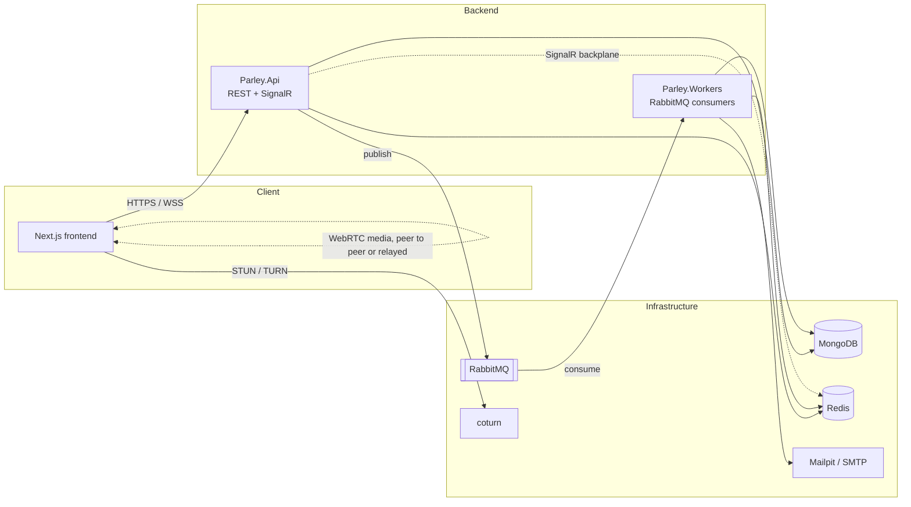
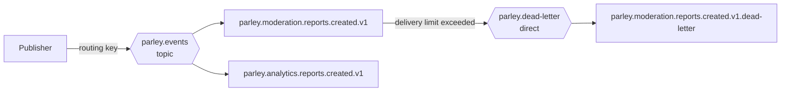
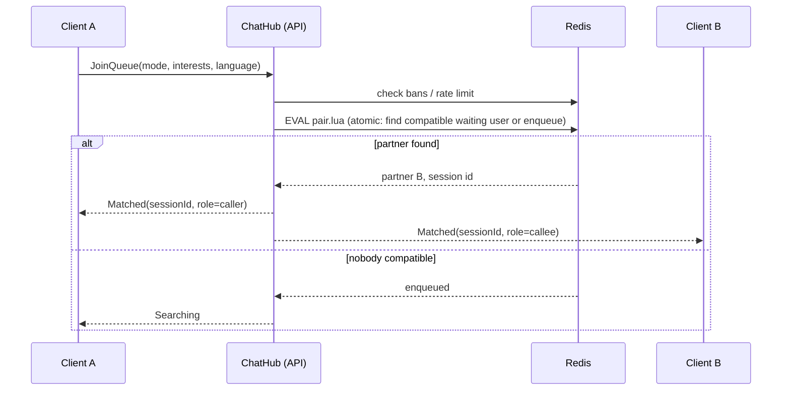
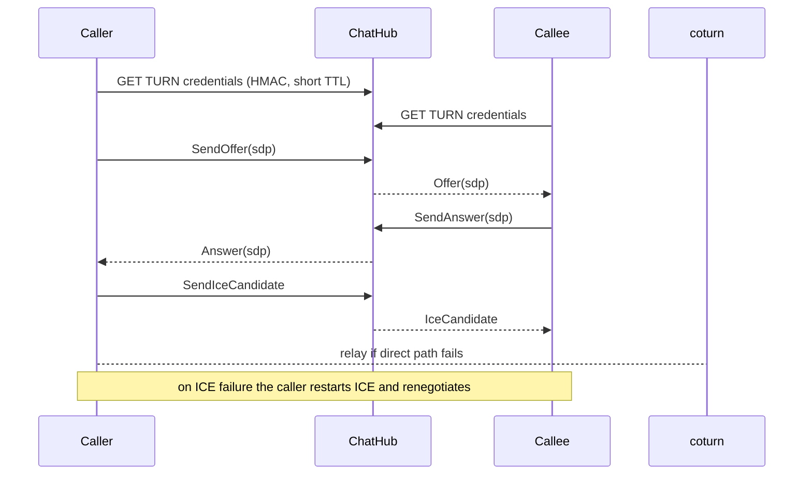
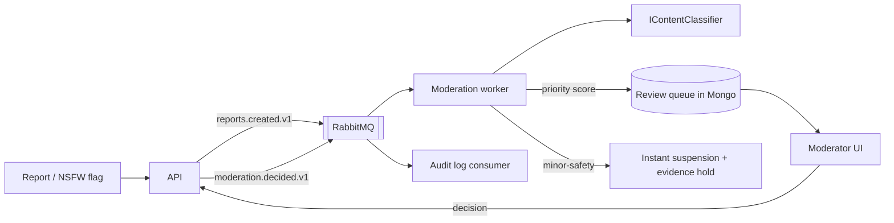

# Architecture

Status: Phase 1 (foundation). Sections marked *planned* describe the target design that later phases implement; update them as features land.

## Components

### Layers

Dependencies point inwards. Infrastructure implements Application ports; hosts compose them.

## Messaging (implemented in Phase 1)
- One durable topic exchange `parley.events`; routing key = `IIntegrationEvent.RoutingKey` (versioned, e.g. `reports.created.v1`).
- Each subscriber declares its own quorum queue `parley.{subscriber}.{routingKey}` with `x-delivery-limit`; failures are requeued, and after the limit the message is dead-lettered through `parley.dead-letter` into `{queue}.dead-letter`. Malformed messages are dead-lettered immediately.
- Publisher confirms: `PublishAsync` completes once the broker has accepted the message.

## Matchmaking flow (planned, Phase 3)

## WebRTC signaling (planned, Phase 4)

## Moderation pipeline (planned, Phase 5)

## Health
- `/health/live`: process is running (used by container health checks).
- `/health/ready`: MongoDB ping, Redis ping, RabbitMQ connection. Returns 503 when any check fails. The payload exposes only component names and statuses.
